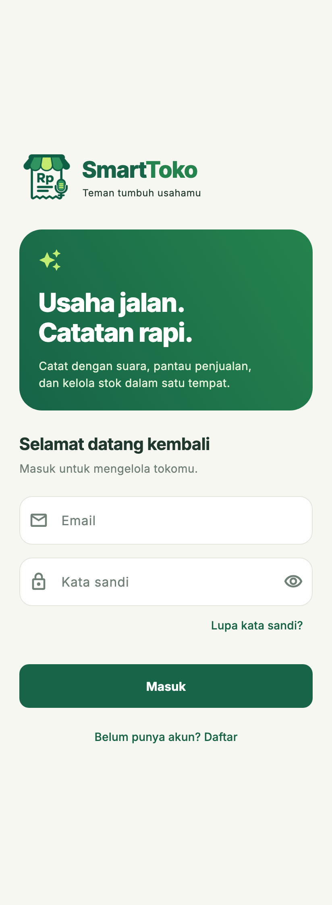
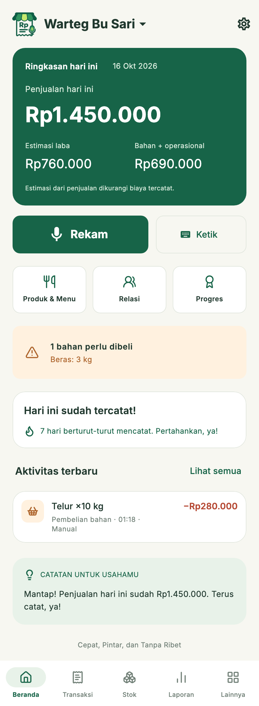
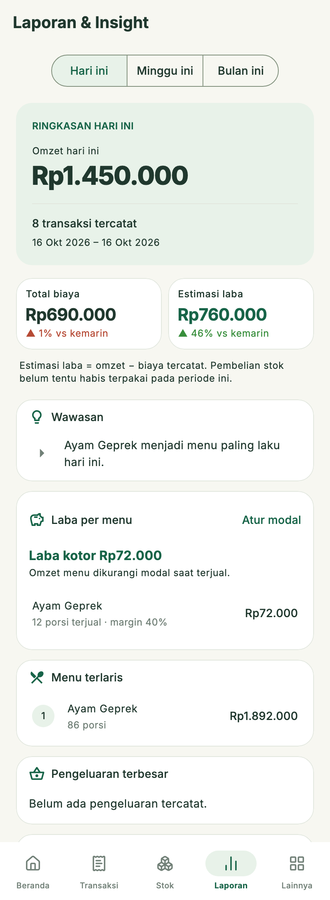
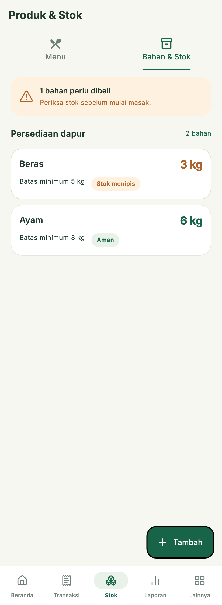

# SmartToko

Aplikasi Android/iOS untuk mencatat pemasukan dan pengeluaran warung lewat
suara atau ketikan. Setiap catatan diperiksa pengguna sebelum disimpan, dan
semua catatan tersimpan di HP (tetap jalan tanpa internet).

**Untuk siapa:** pemilik warung, warteg, toko kelontong, dan pedagang pasar
yang ingin membukukan usahanya tanpa repot mengetik.

**Intinya:** ucapkan *"jual nasi goreng dua lima belas ribu"* dan aplikasi
menyusun catatannya. Kamu periksa, lalu simpan. Dari situ stok, kasbon, laba
per menu, dan laporan ikut terhitung sendiri.

| Masuk | Beranda | Laporan | Stok |
|:---:|:---:|:---:|:---:|
|  |  |  |  |

<sub>Angka pada tangkapan layar hanyalah data contoh untuk pengujian.</sub>

Backend: **Supabase** (Auth, Postgres, Storage, Edge Functions).
Alasan di balik rancangannya ada di [DESIGN_DECISIONS.md](DESIGN_DECISIONS.md).
Review UI Figma, perbaikan terbaru, dan batas pengujiannya ada di
[docs/UI_REVIEW.md](docs/UI_REVIEW.md).

## Fitur

- Daftar/masuk dengan email + kata sandi, konfirmasi email dan reset kata
  sandi dengan **kode OTP** dari email.
- Banyak toko per akun; profil toko bisa diubah.
- Catat transaksi lewat suara atau ketik manual. Draf selalu diperiksa dulu.
- Katalog menu/bahan dan stok yang tumbuh otomatis dari transaksi; kontak
  pelanggan/supplier.
- **Utang & piutang (kasbon):** catat penjualan/pembelian belum dibayar
  (atau ucapkan "Bu Sari ngutang nasi goreng dua lima belas ribu, bayar
  minggu depan"), dengan jatuh tempo opsional. Cicil dan lunasi dari detail
  transaksi, lihat siapa yang belum bayar atau sudah telat, rekam jejak bayar
  tiap pelanggan, dan kirim pengingat lewat WhatsApp.
- **Modal (HPP) dan laba per menu:** isi modal per porsi; laporan
  menghitung laba kotor dan margin tiap menu. Modal disalin ke tiap
  penjualan, jadi mengubah modal tidak mengubah laba masa lalu.
- **Sinkronisasi antar-HP dan karyawan (opsional):** satu toko dipakai di
  beberapa HP; pemilik mengundang karyawan dengan kode. Karyawan bisa
  mencatat, tetapi tidak melihat laporan, laba, dan modal, dan hanya bisa
  mengoreksi catatannya sendiri. Aturan ini ditegakkan server.
- **Pengingat terjadwal (opsional):** pengingat mencatat tiap malam
  (dilewati bila sudah mencatat) dan pengingat pagi untuk kasbon jatuh tempo.
- Riwayat dengan pencarian (barang, catatan, nama) dan filter "Belum
  lunas", laporan, dan export Excel (termasuk status bayar, sisa, dan jatuh
  tempo).
- Bagikan nota penjualan sebagai teks.
- Foto barang (disimpan di HP ini saja).
- Kunci aplikasi dengan PIN, bisa dibuka dengan sidik jari/wajah (mengunci
  tampilan; bukan enkripsi data).
- Bantuan AI (opsional) untuk ucapan yang sulit diurai, lewat server.
- Cadangan cloud (opsional) per toko, dengan pemulihan di HP baru.
- Verifikasi toko (opsional): KTP, foto toko, selfie, NIB, lalu ditinjau
  admin.
- Hapus akun beserta seluruh data dari dalam aplikasi.

## Menjalankan untuk pengembangan

Butuh Flutter dengan Dart sesuai `pubspec.yaml` (`^3.13.4`).

```sh
flutter pub get
flutter analyze
flutter test
flutter run
```

Aplikasi memakai project Supabase di
[lib/core/supabase_config.dart](lib/core/supabase_config.dart). Untuk project
lain, timpa saat build dengan `--dart-define=SUPABASE_URL=...` dan
`--dart-define=SUPABASE_PUBLISHABLE_KEY=...`.

## Menyiapkan Supabase (sekali per project)

### 1. Database, Storage, dan keamanan

Buka **SQL Editor**, tempel seluruh isi
[supabase/setup.sql](supabase/setup.sql), lalu jalankan. Skrip ini aman
dijalankan ulang dan sekaligus memperbarui project yang memakai skrip versi
lama (policy "semua orang boleh baca semua toko" dan fungsi admin tanpa
pemeriksaan role ikut dibuang).

### 2. Authentication

Di **Authentication > Providers > Email**:

- Email provider: aktif.
- Confirm email: aktif (disarankan).
- Minimum password length: 8.

Di **Authentication > Email Templates**, aplikasi memakai **kode**, bukan
tautan. Pastikan kedua template ini memuat `{{ .Token }}`:

- **Confirm signup**, misalnya:
  `Kode konfirmasi SmartToko kamu: {{ .Token }}`
- **Reset Password**, misalnya:
  `Kode untuk membuat kata sandi baru: {{ .Token }}. Abaikan email ini bila kamu tidak memintanya.`

Untuk produksi, pasang **SMTP sendiri** (Authentication > SMTP Settings).
SMTP bawaan Supabase hanya boleh mengirim beberapa email per jam dan tidak
ditujukan untuk pengguna sungguhan.

### 3. Admin peninjau verifikasi

Daftarkan akun admin lewat aplikasi seperti biasa, lalu jalankan di SQL
Editor (ganti emailnya):

```sql
insert into public.admins (user_id)
select id from auth.users where email = 'admin@contoh.com'
on conflict do nothing;
```

Menu **Admin > Tinjau pengajuan verifikasi** baru muncul di Pengaturan untuk
akun itu. Akun lain tidak bisa membaca pengajuan maupun memberi keputusan,
walaupun memanggil API-nya langsung.

### 4. Bantuan AI (Edge Function, opsional)

Fitur ini **mati secara bawaan** dan menunya tidak tampil. Nyalakan hanya
setelah fungsi di-deploy, dengan menambah `--dart-define=AI_ASSIST=true`
saat build.

Butuh [Supabase CLI](https://supabase.com/docs/guides/cli) dan kunci API
Anthropic.

```sh
supabase login
supabase link --project-ref <project-ref>
supabase secrets set ANTHROPIC_API_KEY=sk-ant-...
# opsional, bawaan 200 panggilan per akun per hari:
supabase secrets set LLM_DAILY_LIMIT=200
supabase functions deploy parse-transaction
```

Kunci Anthropic hanya disimpan di server. Pengguna cukup menyalakan sakelar
"Bantuan AI" di Pengaturan.

### 5. Uji otomatis SQL (opsional, butuh Docker)

```sh
supabase/tests/run.sh
```

Menjalankan `setup.sql` dua kali di Postgres sungguhan lalu menguji kebijakan
keamanannya: pemilik tidak bisa menandai tokonya `verified`, tidak bisa
menulis ke folder orang lain, hanya admin yang bisa meninjau, kuota AI,
batas laporan error, dan hapus akun. Skema Supabase ditiru oleh
`supabase/tests/00_shim.sql`, jadi ini menguji logika `setup.sql`, bukan
project Supabase-mu. Uji manual nomor 6 di bawah tetap perlu dijalankan
sekali pada project sungguhan.

### 6. Sinkronisasi dan karyawan

Tidak butuh langkah tambahan selain menjalankan `setup.sql` versi terbaru
(bagian 10). Pemilik menyalakannya di Pengaturan > Sinkronisasi & karyawan.
Mematikannya menghapus data toko itu dari server dan mengeluarkan semua
karyawan; catatan di HP pemilik tetap ada.

### 7. Masuk dengan nomor HP (opsional)

Pasang penyedia SMS (Twilio, Vonage, atau MessageBird) di Authentication >
Providers > Phone, lalu build dengan `--dart-define=PHONE_LOGIN=true`.
Tanpa flag itu pilihan "Masuk dengan nomor HP" tidak ditampilkan.

### 8. Laporan error

Pengguna yang menyalakan "Kirim laporan error" di Pengaturan mengirim
laporan ke tabel `public.client_errors`. Tabel itu tertutup untuk klien;
bacalah lewat SQL Editor:

```sql
select created_at, app_version, platform, error_type, message
from public.client_errors order by created_at desc limit 50;
```

## Build rilis Android

1. Buat keystore upload sekali saja, lalu **simpan cadangannya di tempat
   aman**. Tanpa keystore ini, aplikasi tidak bisa diperbarui di Play Store.

   ```sh
   keytool -genkey -v -keystore ~/smarttoko-upload.jks -keyalg RSA \
     -keysize 2048 -validity 10000 -alias upload
   ```

2. Salin [android/key.properties.example](android/key.properties.example)
   menjadi `android/key.properties` lalu isi. Berkas ini sudah diabaikan git.
3. Naikkan `version` di `pubspec.yaml` (mis. `1.0.1+2`) setiap rilis.
4. Build:

   ```sh
   flutter build appbundle --release
   ```

   Hasilnya `build/app/outputs/bundle/release/app-release.aab`.

Tanpa `android/key.properties`, build release ditandatangani kunci debug.
Itu hanya untuk mencoba di HP sendiri dan tidak bisa diunggah ke Play Store.

ID aplikasi: `com.smarttoko.app` (Android dan iOS). Jangan diganti setelah
rilis pertama.

### Kebutuhan Play Store yang harus disiapkan di luar kode

- **Kebijakan privasi** berupa URL publik. Draf awal ada di
  [docs/PRIVACY_POLICY.md](docs/PRIVACY_POLICY.md) (bagian `[ISI]` harus
  dilengkapi dan ditinjau). Setelah dipublikasikan, pasang URL-nya saat
  build dengan `--dart-define=PRIVACY_URL=https://...` supaya menu
  "Kebijakan privasi" muncul di Pengaturan. Pastikan memuat: data akun dan profil
  toko di server; foto KTP/selfie hanya untuk verifikasi dan hanya dibuka
  admin; cadangan bersifat opsional; transkrip ucapan dikirim ke Anthropic
  hanya bila Bantuan AI dinyalakan; laporan error hanya bila dinyalakan;
  pengenal ucapan Android dapat memproses suara di server Google.
- **Data safety form** dengan isi yang sama.
- Penghapusan akun sudah ada di aplikasi (Pengaturan > Hapus akun).

## Uji manual sebelum rilis

Butuh project Supabase yang sudah disiapkan seperti di atas.

1. **Akun:** daftar, masukkan kode konfirmasi, keluar, lalu masuk lagi. Coba
   "Lupa kata sandi": kode salah ditolak, kode benar mengganti kata sandi dan
   langsung masuk.
2. **Luring:** setelah sekali masuk, matikan internet dan tutup-buka
   aplikasi. Toko harus tetap terbuka dan transaksi tetap bisa dicatat.
3. **Toko:** tambah toko kedua, ganti toko, lalu ubah profil toko.
   Transaksi masuk ke toko yang sedang dipilih.
4. **Cadangan:** nyalakan cadangan, catat transaksi, lalu tunggu cadangan
   terakhir berubah. Pasang ulang aplikasi (atau pakai HP lain), masuk, dan
   pilih "Pulihkan" di layar utama. Transaksi, stok, dan kontak harus kembali.
5. **Verifikasi:** ajukan verifikasi dengan tiga foto wajib. Dari akun admin,
   foto harus tampil di panel admin, lalu setujui atau tolak. Status di HP
   pemilik harus ikut berubah.
6. **Keamanan:** dari akun bukan admin, panggil fungsi admin lewat API
   (mis. `rpc('review_store_verification', ...)`) dan coba update
   `verification_status` langsung. Keduanya harus ditolak.
7. **Bantuan AI:** nyalakan, lalu ucapkan kalimat yang tidak dikenali
   pengurai lokal. Draf tetap harus diperiksa sebelum disimpan.
8. **Hapus akun:** akun, toko, foto, dan cadangan hilang dari Supabase, lalu
   aplikasi kembali ke layar masuk.
9. **Sinkronisasi (dua HP pemilik):** nyalakan di HP A, masuk akun yang sama
   di HP B dan pilih toko itu. Data A muncul di B; transaksi baru, koreksi,
   dan hapus di satu HP muncul di HP lain dalam ±30 detik. Coba juga saat
   salah satu HP luring, lalu sambungkan lagi.
10. **Karyawan:** undang dari HP pemilik, gabung dengan kode di HP lain
    (akun berbeda). Karyawan tidak melihat menu Laporan, tidak bisa
    mengoreksi transaksi pemilik, dan daftar menunya tanpa modal. Keluarkan
    karyawan: tokonya hilang dari HP karyawan saat tersambung.
11. **Pengingat:** nyalakan, atur jam 2 menit dari sekarang, tutup aplikasi.
    Notifikasi harus muncul; setelah mencatat transaksi hari itu, pengingat
    hari itu tidak muncul. Mulai ulang HP: jadwal tetap ada.
12. **Sidik jari/wajah:** pasang PIN, nyalakan biometrik, tinggalkan
    aplikasi >1 menit. Dialog biometrik muncul; batal → PIN tetap bisa.
13. **Rilis:** ulangi nomor 11 dan 12 dengan build `--release`.

## Batasan yang diketahui

- Kunci PIN/biometrik melindungi dari orang yang meminjam HP yang sedang
  menyala. Basis data di HP tidak dienkripsi (lihat
  [DESIGN_DECISIONS.md](DESIGN_DECISIONS.md)).
- Pengingat tagihan ke pelanggan hanya menyiapkan pesan; pengguna yang
  menekan kirim di WhatsApp.
- Sinkronisasi memakai "yang terakhir sampai di server yang berlaku". Bila
  dua orang mengubah transaksi yang sama saat luring, salah satu
  perubahannya tertimpa. Dua HP yang membuat barang bernama sama tetap
  menyatu.
- Foto barang tidak ikut sinkronisasi maupun cadangan.
- Pengingat terjadwal di Android memakai jadwal tidak presisi (bisa mundur
  beberapa menit) supaya tidak butuh izin alarm presisi.
- Pencatatan otomatis dari notifikasi QRIS belum ada (lihat
  DESIGN_DECISIONS.md).
- iOS belum diuji di perangkat nyata.
